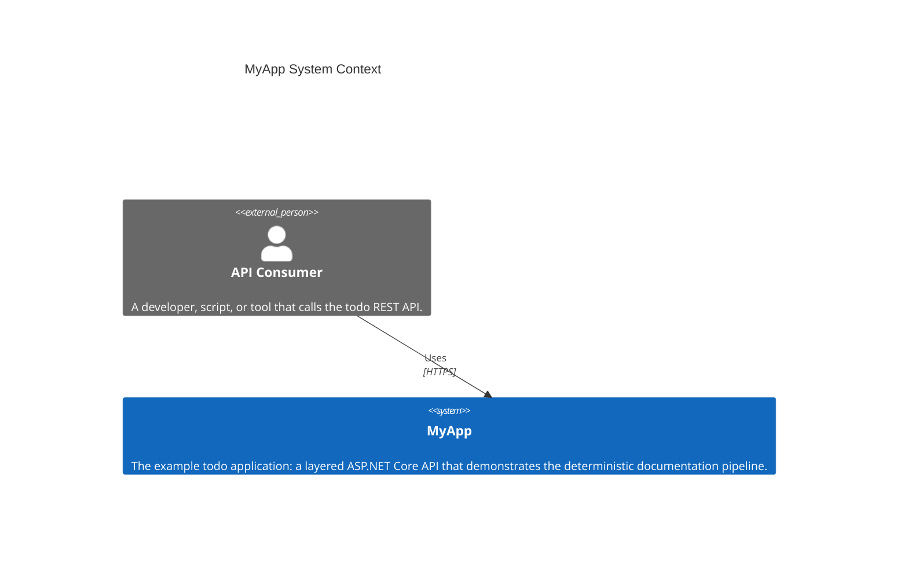
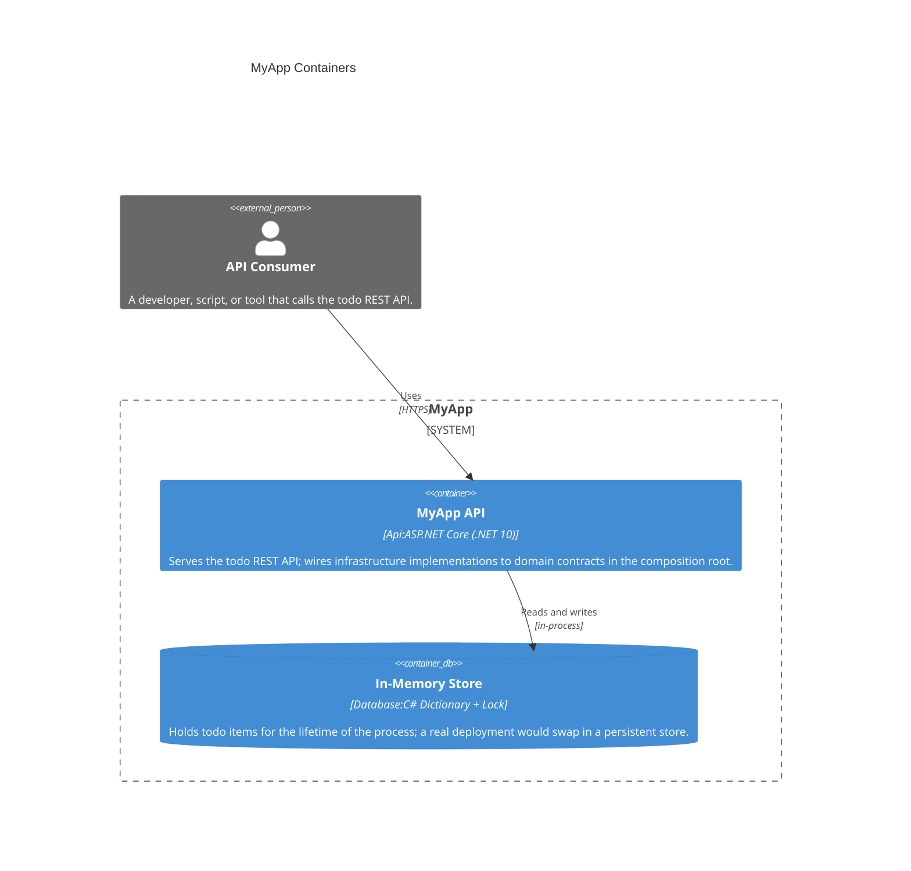
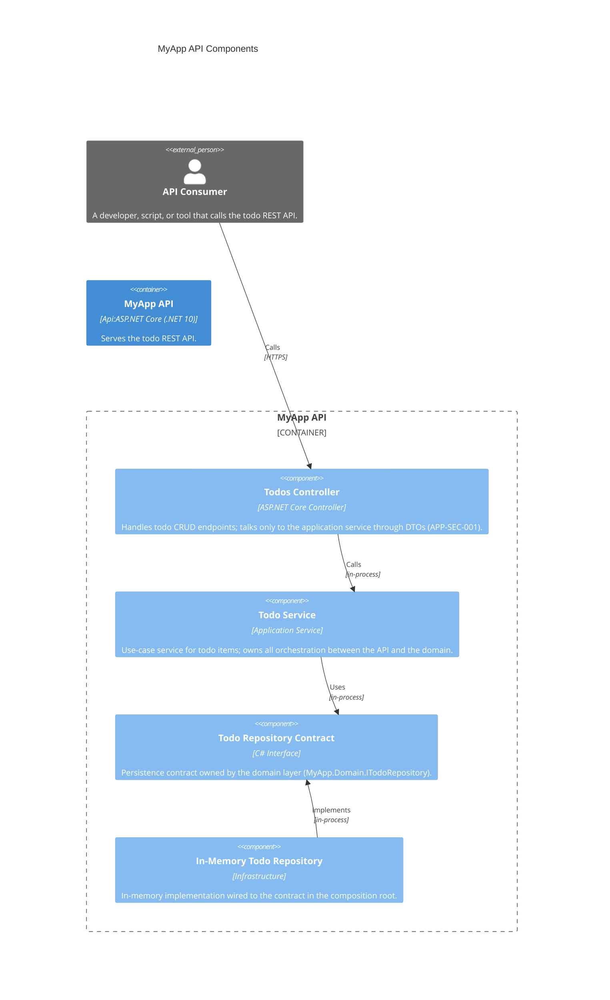

# Architecture Diagrams (C4 Model)

!!! note "Auto-generated"
    This page embeds the Mermaid sources in
    `docs/generated/architecture/` — rendered by the C4Sharp
    generator project `dotnet/tools/MyApp.Architecture.Diagrams`
    (C4 model as code: the diagrams are declared in C# and rebuilt
    by the same deterministic pipeline as every other artefact).
    Re-render with
    `python3 scripts/generate-c4-diagram-docs.py` after regenerating
    the diagrams.

| Field | Value |
|-------|-------|
| **Model** | C4 (Context, Container, Component) |
| **Generator** | C4Sharp 8.1.204 (`dotnet/tools/MyApp.Architecture.Diagrams`) |
| **Output format** | Mermaid (`C4Context` / `C4Container` / `C4Component`) |
| **Generated sources** | `docs/generated/architecture/` |
| **Related Requirements** | [MoSCoW Prioritisation](../requirements/moscow.md) |
| **Related policies** | [Architecture Policies](architecture-policies.md) |

The diagrams are the reviewable source of truth for the application's
structure: they change only in pull requests, together with the code
they describe, and the pipeline re-renders them on every build.

## System Context

The C4 System Context diagram: the API consumer and the MyApp software system, with no internal detail.

## Containers

The C4 Container diagram: the MyApp API container and its in-memory store boundary.

## Components (MyApp API)

The C4 Component diagram of the MyApp API container — controller, application service, the domain repository contract, and its infrastructure implementation. The arrows mirror the strict Api → Application → Domain layering that the NetArchTest policies (APP-ARCH-001/002, APP-SEC-001) enforce.

## Traceability

The C4 model is a traceable pipeline artefact: it is declared as
code, regenerated deterministically, and embedded in this page.
See the
[Traceability Matrix](../traceability/index.md) for the full chain
from MoSCoW requirements to ADRs, policies, and code. The
C4Sharp-over-Mermaid approach will be recorded in the .NET ADR
series (together with the other tooling decisions).
