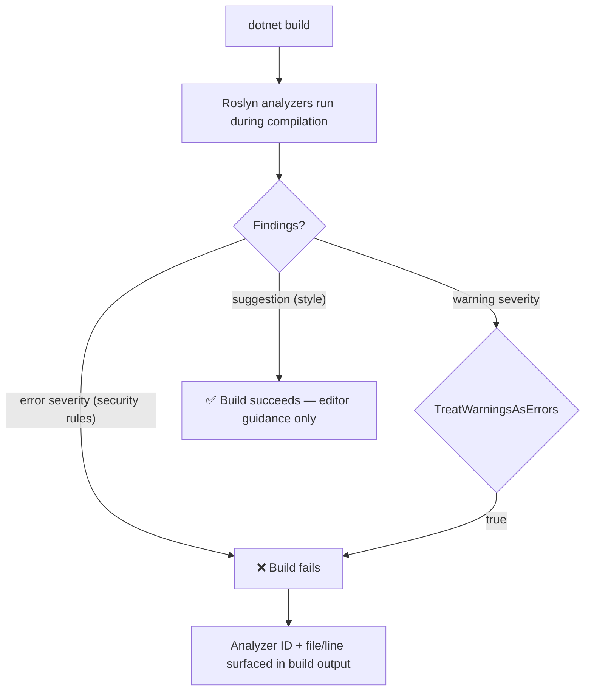

# .NET Code Quality Gate — Roslyn Analyzers

!!! note "Enforced at build time"
    The analyzer gate runs on every `dotnet build` — locally and in CI.
    Any finding at `error` severity fails the build; `warning`-severity
    findings also fail the build because every project sets
    `TreatWarningsAsErrors`. There is no separate scan step and no way to
    merge with a violation.

## Analyzer Packages

All three packages are referenced from `dotnet/Directory.Build.props`, so
every project in the solution inherits them:

| Package | Version | Role |
|---------|---------|------|
| `Microsoft.CodeAnalysis.NetAnalyzers` | 11.0.100 | Platform baseline quality + security rules (supersedes FxCop) |
| `Roslynator.Analyzers` | 5.0.1 | Additional code-quality and style rules |
| `SonarAnalyzer.CSharp` | 10.36.0.15337 | Security and code-smell detection (Sonar rules) |

Versions are pinned so the rule surface is deterministic — upgrading a
package is a deliberate, reviewed change.

## How the Gate Fails the Build



## Enforced Rule Catalogue

Severity is configured in `dotnet/.editorconfig` under
`dotnet_diagnostic.<ID>.severity`.

### Security-critical rules — `error` (build-failing)

| Rule | Source | Description |
|------|--------|-------------|
| `CA3001` | NetAnalyzers | Review SQL queries for security vulnerabilities |
| `CA3002` | NetAnalyzers | Review code for denial-of-service vulnerabilities |
| `CA3003` | NetAnalyzers | Review code for path traversal vulnerabilities |
| `CA3006` | NetAnalyzers | Review code for process command injection |
| `CA3008` | NetAnalyzers | Review code for XSS vulnerabilities |
| `CA3009` | NetAnalyzers | Review code for XML injection vulnerabilities |
| `CA3011` | NetAnalyzers | Review code for XPath injection vulnerabilities |
| `CA3075` | NetAnalyzers | Insecure DllImport / native code exposure |
| `CA5359` | NetAnalyzers | Do not disable certificate validation |
| `CA5364` | NetAnalyzers | Do not use deprecated security protocols |
| `S2077` | SonarAnalyzer | SQL injection |
| `S2068` | SonarAnalyzer | Hard-coded credentials |
| `S2257` | SonarAnalyzer | Hard-coded passwords in configuration |
| `S4830` | SonarAnalyzer | Server certificate validation disabled |
| `S5332` | SonarAnalyzer | Outdated TLS version |
| `S5766` | SonarAnalyzer | Authentication cookie security misconfiguration |

### Code-quality rules — `warning` (build-failing via `TreatWarningsAsErrors`)

| Rule | Source | Description |
|------|--------|-------------|
| `CA1031` | NetAnalyzers | Do not catch general exceptions |
| `CA1062` | NetAnalyzers | Validate arguments of public methods |
| `CA1303` | NetAnalyzers | Pass `IFormatProvider` / use invariant culture |
| `CA2000` | NetAnalyzers | Dispose objects before losing scope |
| `S1066` | SonarAnalyzer | Collapsible `if` statements |
| `S109` | SonarAnalyzer | Magic numbers |
| `RCS1062` | Roslynator | Simplify logical negation |
| `RCS1032` | Roslynator | Remove redundant parentheses |
| `RCS1124` | Roslynator | Inline local variable |

### Style preferences — `suggestion` (editor guidance, non-blocking)

| Rule | Source | Description |
|------|--------|-------------|
| `RCS1001` | Roslynator | Add braces to single-line `if` |
| `RCS1214` | Roslynator | Unnecessary interpolated string |
| `RCS1194` | Roslynator | Use exception parameter |
| `S1135` | SonarAnalyzer | Track uses of `TODO` markers — kept as suggestion because the domain vocabulary of this example app ("todo item") trips the detector |

The default severity of every other rule shipped by the three packages
remains in force (pinned by package version), so the gate cannot silently
soften when dependencies change.

## Relationship to the Other Gates

The Roslyn analyzer gate is the **finest-grained** of the .NET quality gates:

| Gate | Granularity | When |
|------|-------------|------|
| Roslyn analyzers (this page) | Code-level: security patterns, API usage, style | `dotnet build` |
| NetArchTest architecture policies | Coarse-grained: layer dependencies, namespace constraints | `dotnet test` |

Analyzers catch what a single file does wrong; architecture tests catch
what the assembly graph does wrong. Both must pass before documentation
generation runs.

## Verification

A build-failure probe was run during delivery: a deliberately hard-coded
credential (`S2068`) in a throwaway class failed `dotnet build` with

```
error S2068: "password" detected here, make sure this is not a hard-coded credential.
```

The probe was removed and the solution returned to a zero-warning build
(see `dotnet/README.md` for the commands).

## Traceability

- Requirement: **APP-003** (all .NET projects enforce code-quality rules via
  Roslyn analyzers with `TreatWarningsAsErrors`) —
  see [MoSCoW requirements](../requirements/moscow.md).
- Decision record: the analyzer-strategy ADR (Roslyn analyzers + pinned
  packages + `.editorconfig` severities) is documented in the ADR series
  covering the .NET application layer.
- Build wiring: `TreatWarningsAsErrors`, `EnableNETAnalyzers`,
  `AnalysisLevel=latest-recommended` and the package references all live in
  `dotnet/Directory.Build.props`.
