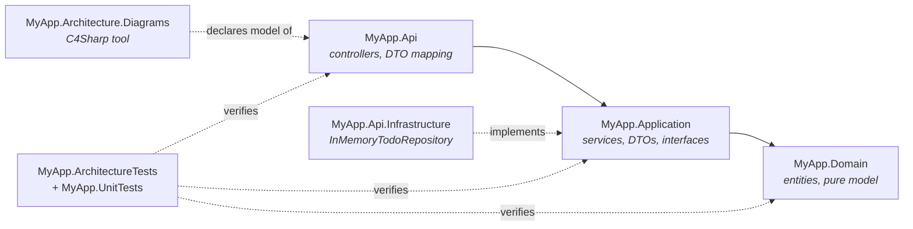

# Application Layer (.NET)

This chapter documents the .NET application layer of the example: a small
layered ASP.NET Core application (`MyApp`) whose quality gates, architecture
policies, API contract, and diagrams are all **deterministically generated
from code** — the same documentation-as-code discipline the pipeline applies
to Terraform, OPA, and DSC.

## Chapter Map

| Page | What it documents | Generated by |
|------|-------------------|--------------|
| [Code Quality Gate](code-quality.md) | The Roslyn analyzer gate: NetAnalyzers, Roslynator, SonarAnalyzer, security rules as errors (`TreatWarningsAsErrors`) | maintained by hand (rules live in `dotnet/Directory.Build.props` + `dotnet/.editorconfig`) |
| [Architecture Policies](architecture-policies.md) | The NetArchTest policy suite: APP-ARCH-001..003, APP-SEC-001 | `scripts/generate-dotnet-policy-docs.py` (from `Policy.Define` metadata in the test suite) |
| [Architecture Diagrams](architecture-diagrams.md) | C4 Context / Container / Component diagrams | `dotnet/tools/MyApp.Architecture.Diagrams` (C4Sharp) + `scripts/generate-c4-diagram-docs.py` |
| [API Reference (OpenAPI)](api-reference.md) | The HTTP API contract | `dotnet build` (native `Microsoft.AspNetCore.OpenApi`) + `scripts/generate-openapi-docs.py` |
| [.NET API Reference (DocFX)](../generated/dotnet-api/MyApp.Domain.md) | The C# API reference, per assembly | DocFX (`dotnet/docs/docfx.json`) |

## Requirements and Decisions

The application layer is governed by the MoSCoW requirements
APP-001 – APP-008 (see [MoSCoW Prioritisation](../requirements/moscow.md))
and the .NET ADR series:

| ADR | Decision |
|-----|----------|
| [ADR-0013](../adrs/0013-docfx-dotnet-api-reference.md) | DocFX for the .NET API reference |
| [ADR-0014](../adrs/0014-netarchtest-architecture-policies.md) | NetArchTest.Rules as the architecture-policy engine |
| [ADR-0015](../adrs/0015-native-dotnet-openapi.md) | Native build-time OpenAPI generation (no Swashbuckle) |
| [ADR-0016](../adrs/0016-roslyn-code-quality-gate.md) | Roslyn analyzers as the code-quality gate |
| [ADR-0017](../adrs/0017-c4sharp-architecture-diagrams.md) | C4Sharp for code-declared C4 diagrams |

The full requirement → ADR → policy → implementation chain is documented in
the [Traceability Matrix](../traceability/index.md#application-layer-traceability-net).

## Layering

The solution lives in `example/dotnet/` and follows a strict layering —
enforced by the NetArchTest policies, not just convention:



Dependencies flow strictly downward (Api → Application → Domain); the domain
layer references nothing above it (APP-ARCH-002), controllers talk only to
application services (APP-ARCH-001) and never expose domain entities over the
wire (APP-SEC-001).

## Running Locally

```bash
cd example/dotnet
dotnet build MyApp.slnx -c Release   # build + Roslyn gate + OpenAPI export
dotnet test MyApp.slnx --no-build    # 9 unit tests + 4 architecture policies
```

See the [Developer Guide onboarding](../onboarding/index.md) for the full
local pipeline walkthrough.
