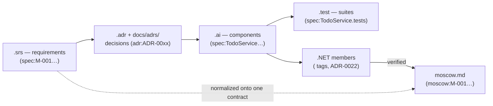
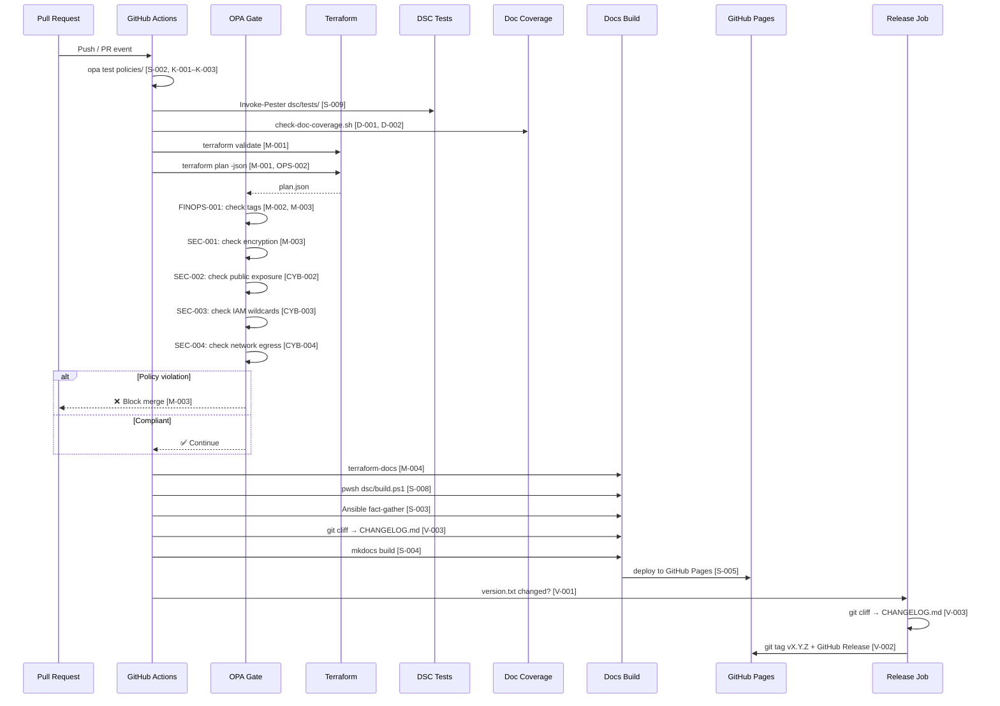
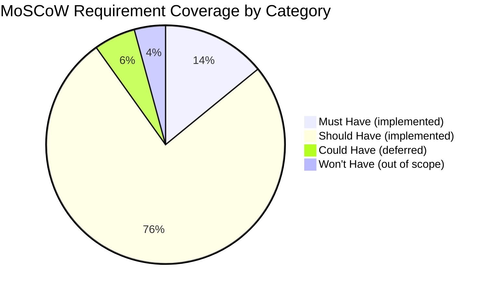

# Traceability Matrix

This page provides a **complete, bidirectional traceability map** between:

- 📋 **MoSCoW Requirements** — the business intent captured in `docs/requirements/moscow.md`
- 📖 **Architectural Decision Records** — the *why* captured in `docs/adrs/`
- 🔒 **OPA Policies** — the automated enforcement in `policies/terraform/`
- 🔒 **.NET Architecture Policies** — the automated enforcement in `dotnet/tests/MyApp.ArchitectureTests/`
- ⚙️ **Infrastructure Code** — the actual implementation in `terraform/`, `dsc/`
- ⚙️ **Application Code** — the .NET example application in `dotnet/`

Every artefact in the repository carries machine-readable metadata (`related_requirements`,
`related_adr`, `__rego__metadoc__`) so that this matrix can be generated
automatically from the source code.

---

## Generated Traceability (ADR-0012)

Since ADR-0012, the traceability substrate is **generated, not hand-drawn**:

- **[architecture-catalog.json](../generated/architecture-catalog.json)** — the
  machine-readable catalog of every ADR, policy metadoc, and MoSCoW requirement,
  regenerated by `scripts/scan-architecture.py` and validated by
  `policies/architecture/validate.rego` in CI.
- **[traceability.drawio](../generated/traceability.drawio)** — the full
  requirement → ADR → policy → implementation diagram in drawio format
  (book diagram conventions), regenerated byte-identically by
  `scripts/generate-traceability.py`; CI fails if the committed diagram drifts
  from the catalog.

The boundary gate (`scripts/architecture-gate.sh`) additionally fails a pull
request that changes a path governed by an Accepted ADR without citing that
ADR (id `ADR-####`) in the PR description.

!!! note "The hand-drawn diagrams below are reading aids"
    The infrastructure graph in the next section predates ADR-0010 and
    ADR-0011 and is retained for reading convenience.  The application-layer
    graph further down mirrors the generated catalog for the .NET ADR series
    (ADR-0013 – ADR-0017).  The authoritative traceability view remains the
    generated catalog and drawio diagram above.

---

## Full Traceability Graph

The diagram below shows the complete chain from business requirement through
architectural decision to enforcement policy and infrastructure code.

```mermaid
graph TB
    subgraph MoSCoW["📋 MoSCoW Requirements"]
        direction TB
        M001["<b>M-001</b><br/>Infrastructure as Code"]
        M002["<b>M-002</b><br/>FinOps Tags Required"]
        M003["<b>M-003</b><br/>OPA Blocks Pipeline"]
        M004["<b>M-004</b><br/>Auto-generated Docs"]
        M005["<b>M-005</b><br/>ADRs Required"]
        M006["<b>M-006</b><br/>Docker Image"]
        S001["<b>S-001</b><br/>OPA Metadoc"]
        S002["<b>S-002</b><br/>OPA Unit Tests"]
        S004["<b>S-004</b><br/>Searchable ADR Index"]
        S005["<b>S-005</b><br/>GitHub Pages"]
        S008["<b>S-008</b><br/>DSC Resources"]
        S009["<b>S-009</b><br/>Pester Tests"]
        CYB002["<b>CYB-002</b><br/>No Public Exposure"]
        CYB003["<b>CYB-003</b><br/>Least-Privilege IAM"]
        CYB004["<b>CYB-004</b><br/>No Unrestricted Egress"]
        A001["<b>A-001</b><br/>C4 Architecture Diagrams"]
        OPS001["<b>OPS-001</b><br/>Operational Runbook"]
        OPS002["<b>OPS-002</b><br/>Network as Code"]
        D001["<b>D-001</b><br/>Doc Coverage Gate"]
        D002["<b>D-002</b><br/>Coverage Rules in VCS"]
        V001["<b>V-001</b><br/>Single Version File"]
        V002["<b>V-002</b><br/>Git Tag on Release"]
        V003["<b>V-003</b><br/>Auto-gen Changelog"]
        FIN001["<b>FIN-001</b><br/>FinOps Persona Page"]
        K001["<b>K-001</b><br/>K8s Manifests + Helm"]
        K002["<b>K-002</b><br/>Resource Limits OPA"]
        K003["<b>K-003</b><br/>No Privileged Containers"]
        DEV001["<b>DEV-001</b><br/>Onboarding Guide"]
        AI001["<b>AI-001</b><br/>Backstage MCP Interface"]
        AI002["<b>AI-002</b><br/>Rich Entity Hierarchy"]
        AI003["<b>AI-003</b><br/>VS Code MCP Config"]
    end

    subgraph ADRs["📖 Architectural Decision Records"]
        direction TB
        ADR001["<b>ADR-0001</b><br/>Terraform for IaC<br/><i>related: M-001, M-004, M-006</i>"]
        ADR002["<b>ADR-0002</b><br/>OPA for Policy<br/><i>related: M-002, M-003, S-001, S-002</i>"]
        ADR003["<b>ADR-0003</b><br/>MkDocs for Publishing<br/><i>related: M-004, M-005, S-004, S-005</i>"]
        ADR004["<b>ADR-0004</b><br/>DSC for Windows Config<br/><i>related: M-005, S-008, S-009</i>"]
        ADR005["<b>ADR-0005</b><br/>Architecture Diagrams<br/><i>related: M-005, A-001, A-002</i>"]
        ADR006["<b>ADR-0006</b><br/>Doc Coverage Gate<br/><i>related: D-001, D-002</i>"]
        ADR007["<b>ADR-0007</b><br/>Semantic Versioning<br/><i>related: V-001, V-002, V-003</i>"]
        ADR008["<b>ADR-0008</b><br/>Kubernetes & Helm<br/><i>related: K-001, K-002, K-003</i>"]
        ADR009["<b>ADR-0009</b><br/>Backstage MCP Server<br/><i>related: AI-001, AI-002, AI-003</i>"]
    end

    subgraph Policies["🔒 OPA Policies"]
        direction TB
        FIN001["<b>FINOPS-001</b><br/>deny_missing_tags.rego<br/><i>HIGH severity</i>"]
        SEC001["<b>SEC-001</b><br/>deny_unencrypted_storage.rego<br/><i>CRITICAL severity</i>"]
        SEC002["<b>SEC-002</b><br/>deny_public_access.rego<br/><i>CRITICAL severity</i>"]
        SEC003["<b>SEC-003</b><br/>deny_public_iam.rego<br/><i>HIGH severity</i>"]
        SEC004["<b>SEC-004</b><br/>deny_unrestricted_network.rego<br/><i>HIGH severity</i>"]
        K8S001POL["<b>K8S-001</b><br/>deny_privileged_containers.rego<br/><i>CRITICAL severity</i>"]
        K8S002POL["<b>K8S-002</b><br/>deny_missing_resource_limits.rego<br/><i>HIGH severity</i>"]
        K8S003POL["<b>K8S-003</b><br/>deny_missing_labels.rego<br/><i>HIGH severity</i>"]
        SC001POL["<b>SC-001</b><br/>deny_nis2_supply_chain.rego<br/><i>HIGH severity</i>"]
        K8S004POL["<b>K8S-004</b><br/>deny_unpinned_image_tag.rego<br/><i>HIGH severity</i>"]
    end

    subgraph IaC["⚙️ Implementation"]
        direction TB
        TF["terraform/main.tf<br/><i>local_file resources</i>"]
        NETW["terraform/network.tf<br/><i>VPC/subnet/NSG/DNS</i>"]
        K8SMAN["kubernetes/<br/><i>Namespace, Deployment, Service</i>"]
        HELM["helm/<br/><i>Helm chart dtds-docs</i>"]
        SCRIPT["scripts/generate-docs.sh"]
        DOCCOV["scripts/check-doc-coverage.sh"]
        DOCKER["Dockerfile"]
        MKDOCS["mkdocs.yml"]
        DSC["dsc/resources/DTDS_FileContent<br/><i>class-based DSC resource</i>"]
        PSTEST["dsc/tests/DTDS_FileContent.Tests.ps1<br/><i>Pester 5 unit tests</i>"]
        DSCBLD["dsc/build.ps1<br/><i>DscResource.DocGenerator</i>"]
        ARCH["docs/architecture/index.md<br/><i>C4 diagrams + tech radar</i>"]
        RUNBOOK["docs/runbook/index.md<br/><i>Operational runbook</i>"]
        VERSION["version.txt + cliff.toml"]
        ONBOARD["docs/onboarding/index.md"]
        MCPCONF["backstage/mcp-clients/\n.vscode/mcp.json"]
        CATINFO["catalog-info.yaml\n(7 entities)"]
    end

    M001 --> ADR001
    M004 --> ADR001
    M006 --> ADR001

    M002 --> ADR002
    M003 --> ADR002
    S001 --> ADR002
    S002 --> ADR002
    CYB002 --> ADR002
    CYB003 --> ADR002
    CYB004 --> ADR002

    M004 --> ADR003
    M005 --> ADR003
    S004 --> ADR003
    S005 --> ADR003

    M005 --> ADR004
    S008 --> ADR004
    S009 --> ADR004

    M005 --> ADR005
    A001 --> ADR005

    D001 --> ADR006
    D002 --> ADR006
    V001 --> ADR007
    V002 --> ADR007
    V003 --> ADR007
    K001 --> ADR008
    K002 --> ADR008
    K003 --> ADR008
    AI001 --> ADR009
    AI002 --> ADR009
    AI003 --> ADR009

    ADR001 --> TF
    ADR001 --> NETW
    ADR001 --> SCRIPT
    ADR001 --> DOCKER

    ADR002 --> FIN001
    ADR002 --> SEC001
    ADR002 --> SEC002
    ADR002 --> SEC003
    ADR002 --> SEC004
    ADR002 --> K8S001POL
    ADR002 --> K8S002POL
    ADR002 --> K8S003POL
    ADR010 --> SC001POL
    ADR008 --> K8S004POL

    ADR003 --> MKDOCS

    ADR004 --> DSC
    ADR004 --> PSTEST
    ADR004 --> DSCBLD

    ADR005 --> ARCH

    ADR006 --> DOCCOV
    ADR007 --> VERSION
    ADR008 --> K8SMAN
    ADR008 --> HELM
    ADR009 --> MCPCONF
    ADR009 --> CATINFO

    OPS001 --> RUNBOOK
    OPS002 --> NETW
    FIN001 --> FINOPS_PAGE
    DEV001 --> ONBOARD

    FIN001 -.->|"enforces M-002"| TF
    SEC001 -.->|"enforces M-003"| TF
    SEC002 -.->|"enforces CYB-002"| TF
    SEC002 -.->|"enforces CYB-002"| NETW
    SEC003 -.->|"enforces CYB-003"| TF
    SEC004 -.->|"enforces CYB-004"| NETW
    PSTEST -.->|"tests S-009"| DSC
    K8S001POL -.->|"enforces K-003"| K8SMAN
    K8S002POL -.->|"enforces K-002"| K8SMAN
    K8S003POL -.->|"enforces K-003/FIN"| K8SMAN
    SC001POL -.->|"enforces NIS2-007"| TF
    K8S004POL -.->|"enforces NIS2-007"| K8SMAN
    DOCCOV -.->|"gates D-001"| SCRIPT
    MCPCONF -.->|"exposes AI-001"| CATINFO
```



---

## Application Layer Traceability (.NET)

The diagram below extends the chain to the .NET application layer introduced
by the ADR series ADR-0013 – ADR-0017.  It is a hand-drawn reading aid that
mirrors the authoritative generated catalog; every edge below is backed by
machine-readable metadata (`related_requirements` in the ADR front-matter,
`Policy.Define` metadata in the NetArchTest suite).

```mermaid
graph TB
    subgraph AppReqs["📋 Application Requirements (MoSCoW)"]
        direction TB
        APP001["<b>APP-001</b><br/>DocFX API Reference<br/><i>Must Have</i>"]
        APP002["<b>APP-002</b><br/>Architecture Tests Block CI<br/><i>Must Have</i>"]
        APP003["<b>APP-003</b><br/>Roslyn Analyzers Gate<br/><i>Must Have</i>"]
        APP004["<b>APP-004</b><br/>Deterministic Build<br/><i>Must Have</i>"]
        APP005["<b>APP-005</b><br/>Native OpenAPI at Build Time<br/><i>Should Have</i>"]
        APP006["<b>APP-006</b><br/>C4 Diagrams from Code<br/><i>Should Have</i>"]
        APP007["<b>APP-007</b><br/>Self-Describing Policy Metadata<br/><i>Should Have</i>"]
        APP008["<b>APP-008</b><br/>Client SDK Generation<br/><i>Could Have — deferred</i>"]
    end

    subgraph AppADRs["📖 .NET ADRs"]
        direction TB
        ADR013["<b>ADR-0013</b><br/>DocFX for .NET API Reference<br/><i>related: APP-001, M-004</i>"]
        ADR014["<b>ADR-0014</b><br/>NetArchTest Architecture Policies<br/><i>related: APP-002, APP-007, M-003</i>"]
        ADR015["<b>ADR-0015</b><br/>Native .NET OpenAPI Generation<br/><i>related: APP-005, APP-008</i>"]
        ADR016["<b>ADR-0016</b><br/>Roslyn Code-Quality Gate<br/><i>related: APP-003, APP-004</i>"]
        ADR017["<b>ADR-0017</b><br/>C4Sharp Architecture Diagrams<br/><i>related: APP-006, M-005</i>"]
    end

    subgraph AppPolicies["🔒 NetArchTest Policies"]
        direction TB
        APPARCH001["<b>APP-ARCH-001</b><br/>Controllers no Repo Depend<br/><i>HIGH severity</i>"]
        APPARCH002["<b>APP-ARCH-002</b><br/>Domain Purity<br/><i>HIGH severity</i>"]
        APPSEC001["<b>APP-SEC-001</b><br/>No Domain Entities in API<br/><i>CRITICAL severity</i>"]
        APPARCH003["<b>APP-ARCH-003</b><br/>Public Members Documented<br/><i>HIGH severity</i>"]
    end

    subgraph AppImpl["⚙️ .NET Implementation"]
        direction TB
        DOTNETAPI["dotnet/src/MyApp.Api<br/><i>controllers + build-time OpenAPI</i>"]
        DOTNETAPP["dotnet/src/MyApp.Application<br/><i>application services + DTOs</i>"]
        DOTNETDOM["dotnet/src/MyApp.Domain<br/><i>domain entities</i>"]
        ARCHTESTS["dotnet/tests/<br/><i>MyApp.ArchitectureTests + UnitTests</i>"]
        OPENAPI["docs/generated/openapi.json<br/><i>OpenAPI 3.1 contract</i>"]
        DOTNETDOCS["docs/generated/dotnet-api/<br/><i>DocFX Markdown export</i>"]
        C4DOCS["docs/generated/architecture/<br/><i>C4 Mermaid diagrams</i>"]
        BUILDPROPS["dotnet/Directory.Build.props<br/><i>+ .editorconfig + global.json</i>"]
    end

    APP001 --> ADR013
    APP002 --> ADR014
    APP007 --> ADR014
    APP005 --> ADR015
    APP008 --> ADR015
    APP003 --> ADR016
    APP004 --> ADR016
    APP006 --> ADR017

    ADR013 --> DOTNETDOCS
    ADR014 --> ARCHTESTS
    ADR015 --> OPENAPI
    ADR016 --> BUILDPROPS
    ADR017 --> C4DOCS

    ADR014 --> APPARCH001
    ADR014 --> APPARCH002
    ADR014 --> APPSEC001
    ADR014 --> APPARCH003

    APPARCH001 -.->|"guards Api to Application"| DOTNETAPI
    APPARCH002 -.->|"guards Domain purity"| DOTNETDOM
    APPSEC001 -.->|"guards API contracts"| DOTNETAPI
    APPARCH003 -.->|"verifies XML docs"| DOTNETAPP
    ARCHTESTS -.->|"enforces APP-002"| DOTNETAPI
    OPENAPI -.->|"rendered from"| DOTNETAPI
    DOTNETDOCS -.->|"rendered from"| DOTNETDOM
    C4DOCS -.->|"declares model of"| DOTNETAPI
```



### Application layer coverage notes

- **APP-001** (DocFX) is satisfied by ADR-0013; the DocFX Markdown export is
  generated into `docs/generated/dotnet-api/` and published under
  *Application → .NET API Reference*.
- **APP-002** (architecture tests block CI) is satisfied by ADR-0014; the four
  NetArchTest policies (APP-ARCH-001/002/003, APP-SEC-001) run in the solution
  test suite.
- **APP-003 / APP-004** (Roslyn gate, deterministic build) are satisfied by
  ADR-0016 via `Directory.Build.props`, `.editorconfig`, and `global.json`.
- **APP-005** (native build-time OpenAPI) is satisfied by ADR-0015; the
  generated `docs/generated/openapi.json` is a traceable pipeline artefact
  rendered into the [API Reference](../application/api-reference.md) page.
- **APP-006** (C4 diagrams from code) is satisfied by ADR-0017 via C4Sharp.
- **APP-007** (self-describing policy metadata) is satisfied by ADR-0014; the
  `Policy.Define` literals drive `scripts/generate-dotnet-policy-docs.py`.
- **APP-008** (client SDK generation) is a *Could Have*; the build-time OpenAPI
  document that would feed NSwag already exists (ADR-0015), so the decision is
  deferred, not blocked.

---

## SpecTree Chain: requirement → decision → component → test → code

Since [ADR-0023](../adrs/0023-spectree-ingestion-first-class-sources.md),
SpecTree files are first-class TDS sources, closing the traceability chain
across both layers (see [ADR-0018](../adrs/0018-spectree-specification-first-ingestion.md)
for the parsers and the [metadata contract](metadata-contract.md) for the
normalized graph):



- **Formats** — `.srs/.adr/.ai/.test/.model/.api/.ns` plus the solution
  manifest live in-tree under `spectree/specs/` (ADR-0023, decision 3),
  parsed to JSON ASTs and normalized onto the shared metadata contract
  (ADR-0019) with namespace-qualified ids.
- **Verification** — the OPA gate (`SPEC-001`, ADR-0020) enforces the
  Minotaur-Grammars validation rules over the graph in CI.
- **Composition** — the TDS composition manifest (ADR-0021) declares
  which sources assemble into the published document.
- **Application code** — `<spec>` XML doc tags (ADR-0022) trace .NET
  members back to requirements, verified against the same contract in
  the docs job.

---

## Policy → Requirement → ADR Matrix

| OPA Policy | Severity | MoSCoW Requirements | Architectural Decision |
|-----------|---------|-------------------|----------------------|
| [FINOPS-001](../compliance/opa-policies.md#finops-001--mandatory-finops-cost-allocation-tags) | HIGH | [M-002](../requirements/moscow.md#must-have), [M-003](../requirements/moscow.md#must-have), [S-001](../requirements/moscow.md#should-have), [S-002](../requirements/moscow.md#should-have) | [ADR-0002](../adrs/0002-use-opa-for-policy.md) |
| [SEC-001](../compliance/opa-policies.md#sec-001--storage-encryption-required) | CRITICAL | [M-003](../requirements/moscow.md#must-have), [S-001](../requirements/moscow.md#should-have) | [ADR-0002](../adrs/0002-use-opa-for-policy.md) |
| [SEC-002](../compliance/opa-policies.md#sec-002--deny-publicly-exposed-resources) | CRITICAL | [M-003](../requirements/moscow.md#must-have), [S-001](../requirements/moscow.md#should-have), [CYB-002](../requirements/moscow.md#should-have--cybersecurity) | [ADR-0002](../adrs/0002-use-opa-for-policy.md) |
| [SEC-003](../compliance/opa-policies.md#sec-003--deny-overly-permissive-iam) | HIGH | [M-003](../requirements/moscow.md#must-have), [S-001](../requirements/moscow.md#should-have), [CYB-003](../requirements/moscow.md#should-have--cybersecurity) | [ADR-0002](../adrs/0002-use-opa-for-policy.md) |
| [SEC-004](../compliance/opa-policies.md#sec-004--deny-unrestricted-network-egress) | HIGH | [M-003](../requirements/moscow.md#must-have), [S-001](../requirements/moscow.md#should-have), [CYB-004](../requirements/moscow.md#should-have--cybersecurity) | [ADR-0002](../adrs/0002-use-opa-for-policy.md) |
| K8S-001 (deny_privileged_containers) | CRITICAL | [K-003](../requirements/moscow.md#should-have--kubernetes), [CYB-002](../requirements/moscow.md#should-have--cybersecurity) | [ADR-0008](../adrs/0008-kubernetes-manifests-and-helm-chart.md) |
| K8S-002 (deny_missing_resource_limits) | HIGH | [K-002](../requirements/moscow.md#should-have--kubernetes), [FIN-001](../requirements/moscow.md#should-have--finops) | [ADR-0008](../adrs/0008-kubernetes-manifests-and-helm-chart.md) |
| K8S-003 (deny_missing_labels) | HIGH | [K-003](../requirements/moscow.md#should-have--kubernetes), [FIN-001](../requirements/moscow.md#should-have--finops) | [ADR-0008](../adrs/0008-kubernetes-manifests-and-helm-chart.md) |
| [SC-001](../compliance/opa-policies.md#sc-001--nis2-supply-chain-iac-dependency-pinning) | HIGH | [NIS2-007](../requirements/moscow.md#should-have--nis2-compliance-eu-20222555) | [ADR-0010](../adrs/0010-nis2-compliance.md) |
| [K8S-004](../compliance/opa-policies.md#k8s-004--no-unpinned-container-image-tags) | HIGH | [NIS2-007](../requirements/moscow.md#should-have--nis2-compliance-eu-20222555), [K-001](../requirements/moscow.md#should-have--kubernetes) | [ADR-0010](../adrs/0010-nis2-compliance.md), [ADR-0008](../adrs/0008-kubernetes-manifests-and-helm-chart.md) |

### .NET Architecture Policies (NetArchTest)

| .NET Policy | Severity | MoSCoW Requirements | Architectural Decision |
|-------------|---------|-------------------|----------------------|
| [APP-ARCH-001](../application/architecture-policies.md#app-arch-001--controllers-must-not-depend-on-repositories) — controllers must not depend on repositories | HIGH | [APP-002](../requirements/moscow.md#must-have), [APP-007](../requirements/moscow.md#should-have--application-layer-net) | [ADR-0014](../adrs/0014-netarchtest-architecture-policies.md) |
| [APP-ARCH-002](../application/architecture-policies.md#app-arch-002--domain-must-not-reference-upper-layers) — domain must not reference upper layers | HIGH | [APP-002](../requirements/moscow.md#must-have), [APP-007](../requirements/moscow.md#should-have--application-layer-net) | [ADR-0014](../adrs/0014-netarchtest-architecture-policies.md) |
| [APP-SEC-001](../application/architecture-policies.md#app-sec-001--controllers-must-not-expose-domain-entities) — controllers must not expose domain entities | CRITICAL | [APP-002](../requirements/moscow.md#must-have), [APP-007](../requirements/moscow.md#should-have--application-layer-net) | [ADR-0014](../adrs/0014-netarchtest-architecture-policies.md) |
| [APP-ARCH-003](../application/architecture-policies.md#app-arch-003--all-public-members-are-documented) — all public members are documented | HIGH | [APP-001](../requirements/moscow.md#must-have), [APP-007](../requirements/moscow.md#should-have--application-layer-net) | [ADR-0014](../adrs/0014-netarchtest-architecture-policies.md) |

---

## ADR → Requirement → Implementation Matrix

| ADR | MoSCoW Requirements | Implementation |
|-----|--------------------|-|
| [ADR-0001](../adrs/0001-use-terraform-for-iac.md) — Terraform for IaC | [M-001](../requirements/moscow.md#must-have), [M-004](../requirements/moscow.md#must-have), [M-006](../requirements/moscow.md#must-have) | `terraform/`, `Dockerfile` |
| [ADR-0002](../adrs/0002-use-opa-for-policy.md) — OPA for Policy | [M-002](../requirements/moscow.md#must-have), [M-003](../requirements/moscow.md#must-have), [S-001](../requirements/moscow.md#should-have), [S-002](../requirements/moscow.md#should-have), CYB-002 – CYB-004 | `policies/terraform/`, `policies/kubernetes/`, `.github/workflows/` |
| [ADR-0003](../adrs/0003-use-mkdocs-for-publishing.md) — MkDocs for Publishing | [M-004](../requirements/moscow.md#must-have), [M-005](../requirements/moscow.md#must-have), [S-004](../requirements/moscow.md#should-have), [S-005](../requirements/moscow.md#should-have) | `mkdocs.yml`, `docs/`, `scripts/` |
| [ADR-0004](../adrs/0004-use-dsc-for-windows-config.md) — DSC for Windows Config | [M-005](../requirements/moscow.md#must-have), [S-008](../requirements/moscow.md#should-have), [S-009](../requirements/moscow.md#should-have) | `dsc/resources/`, `dsc/tests/`, `dsc/build.ps1` |
| [ADR-0005](../adrs/0005-architecture-documentation.md) — Architecture Diagrams | [M-005](../requirements/moscow.md#must-have), A-001, A-002 | `docs/architecture/index.md` |
| [ADR-0006](../adrs/0006-enforce-doc-coverage-gate.md) — Doc Coverage Gate | [D-001](../requirements/moscow.md#should-have--documentation-governance), [D-002](../requirements/moscow.md#should-have--documentation-governance) | `scripts/check-doc-coverage.sh`, CI `doc-coverage` job |
| [ADR-0007](../adrs/0007-semantic-versioning-and-changelog.md) — Semantic Versioning | [V-001](../requirements/moscow.md#should-have--versioning--changelog), [V-002](../requirements/moscow.md#should-have--versioning--changelog), [V-003](../requirements/moscow.md#should-have--versioning--changelog) | `version.txt`, `cliff.toml`, CI `release` job |
| [ADR-0008](../adrs/0008-kubernetes-manifests-and-helm-chart.md) — Kubernetes & Helm | [K-001](../requirements/moscow.md#should-have--kubernetes), [K-002](../requirements/moscow.md#should-have--kubernetes), [K-003](../requirements/moscow.md#should-have--kubernetes) | `kubernetes/`, `helm/`, `policies/kubernetes/` |
| [ADR-0009](../adrs/0009-backstage-mcp-server.md) — Backstage MCP Server | [AI-001](../requirements/moscow.md#should-have--ai--mcp-integration), [AI-002](../requirements/moscow.md#should-have--ai--mcp-integration), [AI-003](../requirements/moscow.md#should-have--ai--mcp-integration) | `catalog-info.yaml`, `backstage/app-config.yaml`, `.vscode/mcp.json`, `backstage/mcp-clients/` |
| [ADR-0010](../adrs/0010-nis2-compliance.md) — NIS2 Compliance | NIS2-001 – NIS2-007, [M-003](../requirements/moscow.md#must-have), [S-001](../requirements/moscow.md#should-have), CYB-002 – CYB-004 | `docs/compliance/nis2.md`, `policies/terraform/deny_nis2_crypto.rego`, `policies/terraform/deny_nis2_supply_chain.rego` |
| [ADR-0011](../adrs/0011-dora-compliance.md) — DORA Compliance | DORA-001 – DORA-006, [M-003](../requirements/moscow.md#must-have), [S-001](../requirements/moscow.md#should-have) | `docs/compliance/dora.md`, `policies/terraform/deny_dora_ict_risk.rego` |
| [ADR-0012](../adrs/0012-machine-readable-adr-traceability.md) — ADR Traceability Kit | [S-006](../requirements/moscow.md#should-have), [M-005](../requirements/moscow.md#must-have), [D-001](../requirements/moscow.md#should-have--documentation-governance) | `scripts/scan-architecture.py`, `scripts/generate-traceability.py`, `scripts/architecture-gate.sh`, `policies/architecture/`, `docs/generated/architecture-catalog.json` |
| [ADR-0013](../adrs/0013-docfx-dotnet-api-reference.md) — DocFX for .NET API Reference | [APP-001](../requirements/moscow.md#must-have), [M-004](../requirements/moscow.md#must-have) | `dotnet/docs/docfx.json`, `dotnet/dotnet-tools.json`, `docs/generated/dotnet-api/` |
| [ADR-0014](../adrs/0014-netarchtest-architecture-policies.md) — NetArchTest Architecture Policies | [APP-002](../requirements/moscow.md#must-have), [APP-007](../requirements/moscow.md#should-have--application-layer-net), [M-003](../requirements/moscow.md#must-have) | `dotnet/tests/MyApp.ArchitectureTests/`, `scripts/generate-dotnet-policy-docs.py`, `docs/application/architecture-policies.md` |
| [ADR-0015](../adrs/0015-native-dotnet-openapi.md) — Native .NET OpenAPI Generation | [APP-005](../requirements/moscow.md#should-have--application-layer-net), [APP-008](../requirements/moscow.md#could-have) | `dotnet/src/MyApp.Api/MyApp.Api.csproj`, `scripts/generate-openapi-docs.py`, `docs/generated/openapi.json`, `docs/application/api-reference.md` |
| [ADR-0016](../adrs/0016-roslyn-code-quality-gate.md) — Roslyn Code-Quality Gate | [APP-003](../requirements/moscow.md#must-have), [APP-004](../requirements/moscow.md#must-have) | `dotnet/Directory.Build.props`, `dotnet/.editorconfig` |
| [ADR-0017](../adrs/0017-c4sharp-architecture-diagrams.md) — C4Sharp Architecture Diagrams | [APP-006](../requirements/moscow.md#should-have--application-layer-net), [M-005](../requirements/moscow.md#must-have) | `dotnet/tools/MyApp.Architecture.Diagrams/`, `scripts/generate-c4-diagram-docs.py`, `docs/generated/architecture/`, `docs/application/architecture-diagrams.md` |

---

## CI/CD Pipeline Traceability

The following diagram shows exactly where each requirement is enforced in the
automated pipeline.



---

## Requirement Coverage Summary



!!! success "All Must-Have and Should-Have requirements are covered"
    Every M-xxx, S-xxx, D-xxx, V-xxx, FIN-xxx, K-xxx, DEV-xxx, AI-xxx,
    NIS2-xxx, DORA-xxx, and APP-xxx requirement in the MoSCoW document has at
    least one ADR, OPA policy, or implementation artefact that satisfies it.
    The traceability metadata in each source file makes this verifiable
    automatically.

---

## How Traceability Metadata Is Maintained

### In OPA policies (`__rego__metadoc__`)

```rego
__rego__metadoc__ := {
    "id": "FINOPS-001",
    "title": "Mandatory FinOps Cost-Allocation Tags",
    ...
    "related_adr":          ["ADR-0002"],
    "related_requirements": ["M-002", "M-003", "S-001", "S-002"],
}
```

### In ADR front-matter (YAML)

```yaml
---
id: ADR-0004
title: Use PowerShell DSC for Windows Configuration Management
...
related_requirements: [M-005, S-008, S-009]
---
```

### In .NET architecture policies (`Policy.Define`)

```csharp
Policy.Define("APP-ARCH-001",
    "Controllers must not depend on repository contracts directly")
```

Both infrastructure formats plus the .NET `Policy.Define` metadata are
machine-readable: the CI/CD pipeline or a custom script can parse them to
regenerate this traceability page automatically whenever policies or ADRs
change.
